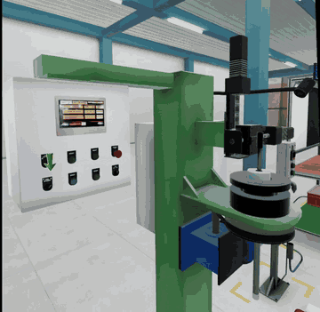
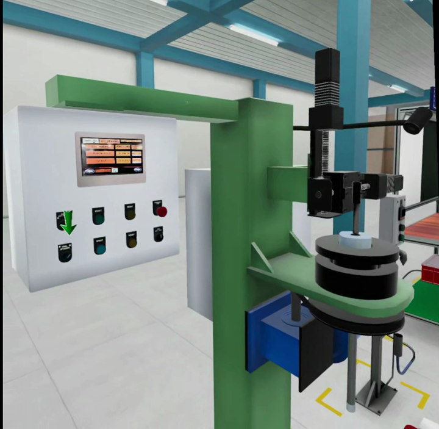
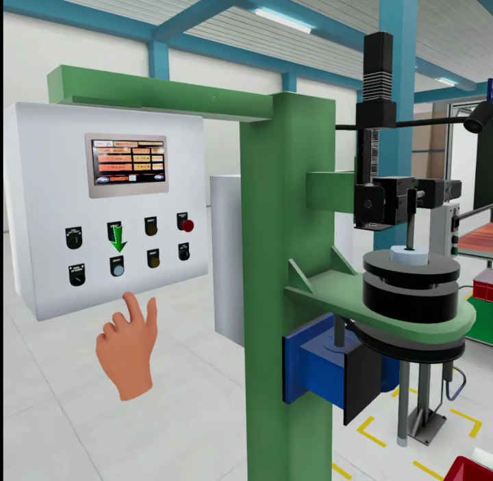
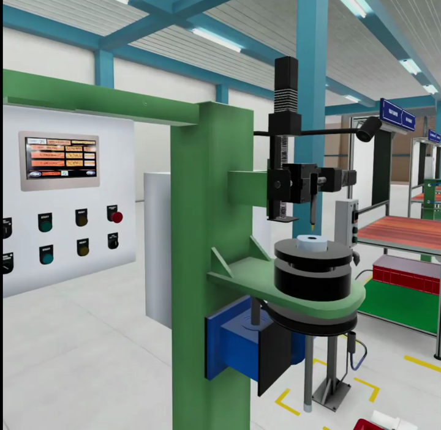
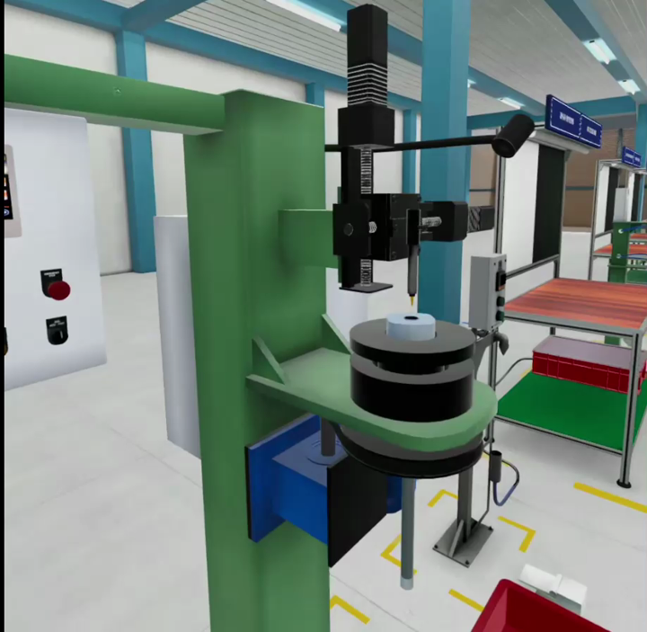
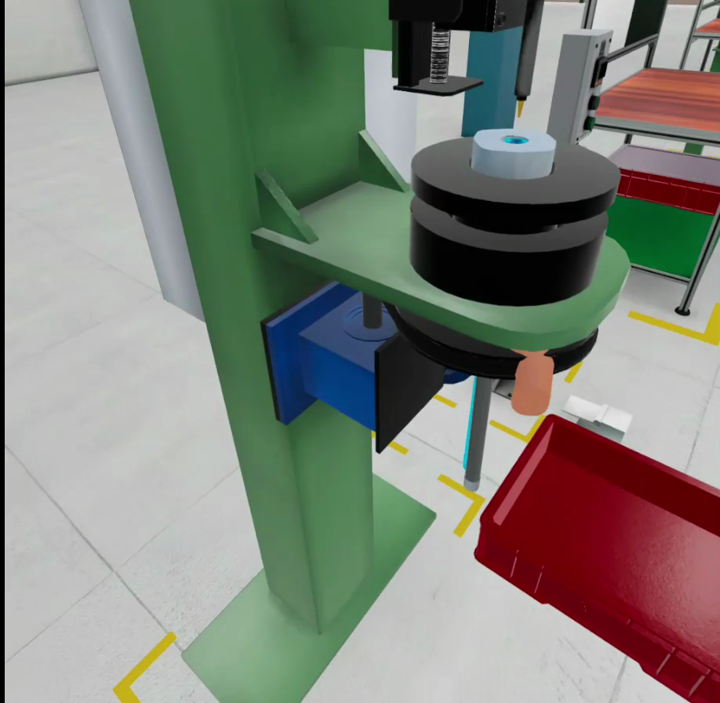
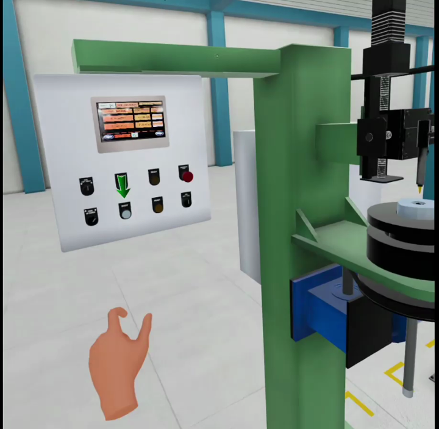

# Industrial Hose Manufacturing VR Training

**Unity · C# · VR**

An interactive VR trainer for the industrial hose manufacturing process, built
in Unity. Trainees learn by operating virtual equipment with their hands,
following guided procedures and working through structured learning sequences.

▶ **Full gameplay video:** [media/gameplay-demo.mp4](media/gameplay-demo.mp4)

## Overview

This project simulates a hose manufacturing cell in virtual reality. Instead of
reading a manual, the trainee stands at the machine, uses the control panel and
learns the correct operating sequence step by step, with on-screen guidance
showing what to do next.

## Features

- Interactive equipment: control panel with pushbuttons, selector switches,
  HMI screen and emergency stop
- Hand-tracked interaction: press buttons and operate the machine naturally
- Guided procedures: animated arrows highlight the next control in the process
- Learning sequences: the manufacturing process is broken into clear, ordered steps
- Real-time 3D factory environment with machinery, safety markings and material bins
- Optimised interactions and scene setup for stable XR performance

## Screenshots

| | |
|---|---|
|  |  |
| Control panel | Button interaction |
|  |  |
| Machine station | Guided step indicator |
|  |  |
| Workpiece close-up | Procedure step |

## Tech Stack

- Unity
- C#
- VR (standalone headset, hand tracking)

## My Role

Interactive VR developer: equipment interactions, guided procedures, learning
sequences, 3D environment setup and XR performance optimisation.

## Note

This repository is a showcase of the project (video and screenshots).
The source code and build are not publicly included.

## Contact

Sriram S · [GitHub](https://github.com/sriram-game-dev)
